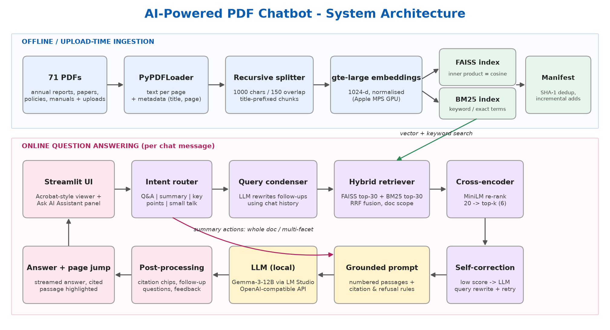

# AI-Powered PDF Chatbot — Capstone Project

*Author: Meet Kumar Jain · Agentic AI Training (Batch 3, 2026)*

An **Adobe Acrobat "Ask AI Assistant"–style** chatbot that lets users talk to PDF documents in natural language.
It is a fully local **Retrieval-Augmented Generation (RAG)** system: PDFs → text → chunks → embeddings → FAISS/BM25 →
hybrid retrieval + re-ranking → grounded prompt → local LLM → answer with clickable page citations in a Streamlit UI.



## Deliverables

| Deliverable | File |
|---|---|
| Working prototype | `app.py` + `rag/` (run instructions below) |
| Presentation (architecture & workflow) | [`deliverables/AI_PDF_Chatbot_Capstone.pptx`](deliverables/AI_PDF_Chatbot_Capstone.pptx) and `.pdf` |
| Approach, models, tools & techniques | [`deliverables/Approach_and_Design.md`](deliverables/Approach_and_Design.md) and `.pdf` |
| Demo video (narrated, 7 min 15 s) | [`deliverables/demo_video.mp4`](deliverables/demo_video.mp4) — script: [`demo_script.md`](deliverables/demo_script.md) |
| Submission highlights (shareable summary) | [`deliverables/Submission_Highlights.pdf`](deliverables/Submission_Highlights.pdf) and `.md` |
| How to run & test locally (5-minute checklist) | [`deliverables/How_to_Run_Locally.pdf`](deliverables/How_to_Run_Locally.pdf) and `.md` |
| Evaluation report | [`deliverables/evaluation_results.md`](deliverables/evaluation_results.md), LLM comparison: [`model_comparison.md`](deliverables/model_comparison.md) |
| Screenshots | `deliverables/screenshots/` |

## Features

* **Acrobat-like UI** – top bar, "Save time with a document summary" banner, PDF viewer (page navigation, zoom) and the
  *Ask AI Assistant* side panel with suggestion cards (*Summarize*, *Identify what stands out*, *Suggest questions*, *List takeaways*).
* **Grounded answers with citations** – inline numbered badges; source chips jump the viewer to the page and
  **highlight the cited passage**.
* **Hybrid retrieval** – FAISS dense search (gte-large) + BM25 keyword search fused with Reciprocal Rank Fusion,
  then **cross-encoder re-ranking** (ms-marco-MiniLM).
* **Conversation memory** – follow-ups ("can it be split?") are condensed into standalone questions.
* **Self-correction / guardrail** – low re-ranker relevance triggers an LLM query rewrite and retry; otherwise the
  assistant answers "I couldn't find that…" instead of hallucinating.
* **Whole-document actions** – full-text stuffing for short PDFs, multi-facet retrieval for long ones (10-Ks, papers).
* **Scopes** – *This document*, *This document + added files*, or *All documents* (PDF-Space-like cross-document Q&A).
* **Upload any PDF** – incremental ingestion (SHA-1 de-duplication), immediately searchable.
* Follow-up question suggestions, 👍/👎 feedback, retrieval trace for debugging, configurable settings (⋯ menu).
* **Model picker + "Compare models"** – choose any model served by LM Studio/Ollama under the scope selector, or
  toggle *Compare models* to see 2–3 LLMs answer the same question side by side (same retrieved passages, with
  latency and citation counts). See [`deliverables/model_comparison.md`](deliverables/model_comparison.md).

## LLM comparison (33 questions + 3 out-of-scope, same retrieval)

| Model | Accuracy | Cited | Refused out-of-scope | Avg latency |
|---|---|---|---|---|
| **gemma-3-12b-it** (default) | 100% | 100% | 100% | 4.6 s |
| qwen2.5-7b-instruct | 100% | 97% | 100% | 2.0 s |
| llama-3.2-3b-instruct | 94% | 88% | 100% | 2.5 s |

To add models for the picker / comparison (LM Studio):

```bash
lms get qwen2.5-7b-instruct            # or download the GGUF from Hugging Face into ~/.lmstudio/models
lms load qwen2.5-7b-instruct --context-length 16384
lms load llama-3.2-3b-instruct --context-length 16384
python scripts/eval_rag.py --models gemma-3-12b-it,qwen2.5-7b-instruct,llama-3.2-3b-instruct
```

## Corpus (71 PDFs, ~2,330 pages, 9,834 chunks)

| Collection | PDFs | Source |
|---|---|---|
| Financial annual reports | 12 | Adobe, Alphabet, Microsoft 10-K / annual reports FY2021–2024 (Session 2 dataset) |
| AI research papers | 33 | Public arXiv papers (RAG, Transformer, ReAct, Self-RAG, FAISS, HNSW, …) — `scripts/download_corpus.py` |
| Government frameworks | 3 | NIST AI RMF 1.0, NIST CSF 2.0, NIST AI 600-1 (public domain) |
| Company policies & manuals | 23 | Synthetic "Veridian Systems" policies, manuals, QBRs (`scripts/generate_synthetic_pdfs.py`) with known facts for evaluation |

> **Repository note:** the 33 arXiv papers (`data/pdfs/research/`) and the FAISS index (`index/`) are not stored in
> Git. `python scripts/download_corpus.py` re-downloads the papers and `python scripts/build_index.py` rebuilds the
> index (about 6 minutes). The company, financial and NIST PDFs are included.

## Quick start

```bash
cd capstone_pdf_chatbot
python3 -m venv .venv && source .venv/bin/activate
pip install -r requirements.txt

# 1. LLM: LM Studio (default) – load gemma-3-12b-it with >= 16k context and start the server on :1234
lms load gemma-3-12b-it --context-length 16384
#    ...or Ollama:  export LLM_BASE_URL=http://localhost:11434/v1 LLM_MODEL=gemma3:12b

# 2. Corpus + index (one-off, ~6 min on Apple M3 Max)
python scripts/download_corpus.py
python scripts/generate_synthetic_pdfs.py
python scripts/build_index.py

# 3. Run the app
streamlit run app.py            # http://localhost:8501
```

Optional:

```bash
python scripts/eval_rag.py              # retrieval + answer evaluation -> deliverables/evaluation_results.md
python scripts/ui_smoke_test.py         # browser test of the real UI (Playwright)
python scripts/record_demo.py           # re-record the narrated demo video
python scripts/make_diagrams.py         # architecture / workflow figures
python scripts/make_presentation.py     # PPTX + PDF deck
python scripts/make_approach_doc.py     # approach, how-to-run and highlights PDFs
```

## Configuration (environment variables, see `config.py`)

| Variable | Default | Meaning |
|---|---|---|
| `LLM_BASE_URL` | `http://localhost:1234/v1` | Any OpenAI-compatible endpoint (LM Studio, Ollama, OpenAI) |
| `LLM_MODEL` | `gemma-3-12b-it` | Chat model id |
| `EMBEDDINGS_MODEL` | `thenlper/gte-large` | Sentence-transformers embedding model |
| `RERANKER_MODEL` | `cross-encoder/ms-marco-MiniLM-L-6-v2` | Cross-encoder re-ranker |
| `CHUNK_SIZE` / `CHUNK_OVERLAP` | `1000` / `150` | Recursive splitter parameters |
| `TOP_K` | `6` | Passages sent to the LLM |
| `RELEVANCE_THRESHOLD` | `-4.0` | Re-ranker score below which self-correction kicks in |

## Project layout

```
app.py                     Streamlit UI (Acrobat-style viewer + Ask AI Assistant panel)
config.py                  configuration
assets/acrobat.css         look & feel
rag/loader.py              PyPDFLoader, cleaning, recursive chunking (steps 1-3)
rag/knowledge_base.py      embeddings, FAISS + BM25, RRF fusion, cross-encoder re-ranking, ingestion (steps 4-7)
rag/assistant.py           intent routing, condensation, self-correction, grounded prompts, citations (step 8)
rag/llm.py                 OpenAI-compatible LLM client (step 9)
rag/viewer.py              PDF page rendering + passage highlighting (PyMuPDF)
scripts/                   corpus, indexing, evaluation, UI test, demo recording, deck & doc generation
data/pdfs/                 the corpus (company / financial / research / government / uploads)
index/                     persisted FAISS index + manifest
deliverables/              presentation, approach document, demo video, evaluation, screenshots
```

> The "Veridian Systems" documents are fictional and generated for demonstration. arXiv papers and NIST publications
> are downloaded from their public sources for educational, non-commercial use.
