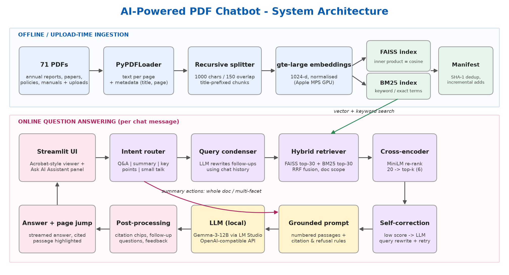

# AI-Powered PDF Chatbot — Approach, Models, Tools & Techniques

*Meet Kumar Jain · Capstone Case Study · Agentic AI Training (Batch 3, 2026)*

**Source code:** <https://github.com/meejain/capstone_pdf_chatbot>

## 1. Problem and goal

Organisations hold large volumes of reports, manuals, research papers and policy documents. Finding a specific
fact manually is slow. The goal was an **AI chatbot that lets users interact with PDF documents in natural
language**. It should answer questions, explain, and summarise, using only the content of the documents.

We used the **Adobe Acrobat AI Assistant** as the target experience. The app has a PDF viewer next to an
*Ask AI Assistant* panel with suggestion cards. Answers carry citations that take you back to the page. We added
three constraints of our own:

* It runs **fully locally** for privacy. No document leaves the machine.
* It scales to a **library of 50–100+ PDFs** as well as ad-hoc uploads.
* Every answer must be **verifiable**: each one cites its source pages, and the assistant refuses when the answer isn't there.

## 2. Approach: Retrieval-Augmented Generation (RAG)

An LLM's own knowledge is static and knows nothing about private documents. Its context window also cannot hold a
2,300-page library. RAG solves this by retrieving only the most relevant passages at question time and asking the
LLM to answer from them.

```
PDF → Extract text → Chunk → Embed → Vector store → Retrieve relevant chunks → Context + Question → LLM → Answer → Chat UI
```



### 2.1 Ingestion (offline for the library, seconds for an upload)

| Step | Technique | Choice & justification |
|---|---|---|
| Load | `PyPDFLoader` (LangChain), one Document per page | Extracts text and keeps **page numbers** for citations. A **PyMuPDF** fallback handles unusual or encrypted PDFs. |
| Clean | De-hyphenation, whitespace normalisation, skip blank pages | Gives more accurate embeddings and BM25 tokens. |
| Chunk | `RecursiveCharacterTextSplitter`, **1000 chars / 150 overlap**, separators ¶ → line → sentence → word | About 250 tokens fits inside gte-large's 512-token window. Paragraphs and table rows stay intact, and the overlap preserves context across chunk boundaries. The Session 2 setting of 512/50 cut 10-K tables in half. |
| Enrich | Metadata: `source, title, page, category, chunk_id`; the chunk text is **prefixed with the document title** | Makes citations and per-document filtering possible. The prefix lets "Adobe FY2023 revenue" match the right report. |
| Embed | **`thenlper/gte-large`** (1024-d) via `HuggingFaceEmbeddings`, normalised, on the Apple MPS GPU | Strong open model on retrieval benchmarks, runs locally and costs nothing. Normalising the vectors makes inner product equal cosine similarity. |
| Store | **FAISS** (`IndexFlatIP`) plus a **BM25** keyword index; `manifest.json` with SHA-1 de-duplication | Exact search over 9.8k vectors takes under 20 ms. `IDSelectorBatch` restricts a search to the open document. BM25 catches exact codes and numbers. |

### 2.2 Question answering (per message)

1. **Intent router.** Separates free-form Q&A, the whole-document actions (*Summarize*, *Identify what stands
   out*, *Suggest questions*, *List takeaways*) and small talk.
2. **Query condensation (conversation memory).** An LLM rewrites a follow-up such as *"Can it be split?"* into a
   standalone question using the chat history, as covered in the Advanced RAG session.
3. **Hybrid retrieval.** FAISS top-30 and BM25 top-30 are fused with **Reciprocal Rank Fusion** (k = 60). The scope
   can be the open document, the document plus files you added, or the whole library.
4. **Re-ranking.** The `cross-encoder/ms-marco-MiniLM-L-6-v2` model scores the 20 fused candidates against the
   question, and the top 6 go to the LLM.
5. **Self-correction (agentic step).** If the best re-rank score is below −4, the LLM rewrites the query into
   keywords and retrieval is repeated. If the passages are still irrelevant, the prompt makes the model reply
   *"I couldn't find that in the selected document(s)."*
6. **Grounded prompt.** The passages are numbered `[n] (Document, page)`. The system rules are:
   * use only these passages
   * cite `[n]` after each statement
   * never guess numbers
   * use tables for comparisons
   * refuse when the answer is absent
7. **Generation.** **Gemma-3-12B-it** runs locally in **LM Studio** behind an OpenAI-compatible API
   (LangChain `ChatOpenAI`). Settings are a 16k-token context and temperature 0.1, and the answer is streamed to the UI.
8. **Post-processing.**
   * Citations become badges and source chips; clicking one jumps to the page and **highlights the passage** (PyMuPDF).
   * Three follow-up questions are suggested.
   * 👍/👎 feedback, plus an optional retrieval trace.

**Whole-document actions.** If a document is under 24k characters, its full text is "stuffed" into the prompt.
For long documents such as 10-Ks and papers, we use **multi-facet retrieval**. The first pages are combined with
targeted searches for the overview, results, conclusions and risks, which avoids summarising only the
introduction.

## 3. Models and tools

| Layer | Tool / model | Notes |
|---|---|---|
| UI | **Streamlit** 1.67 with custom CSS | Uses `st.chat_input`, `st.chat_message` styling, `session_state`, popovers, keyed containers and streaming |
| Orchestration | **LangChain** (loaders, splitters, embeddings, FAISS wrapper, ChatOpenAI) | Each stage has a standard interface, so a stage can be swapped out |
| PDF | **pypdf** via PyPDFLoader; **PyMuPDF** for rendering, highlighting and fallback extraction | |
| Embeddings | **thenlper/gte-large** (sentence-transformers) | Alternatives: all-MiniLM-L6-v2 (faster, lower recall), nomic-embed |
| Vector search | **FAISS** + **rank_bm25** | Alternatives: Chroma (Session 2), pgvector. HNSW isn't needed below about 1M vectors |
| Re-ranker | **cross-encoder/ms-marco-MiniLM-L-6-v2** | Adds about 40–60 ms and a large precision gain; also powers the relevance guardrail |
| LLM | **Gemma-3-12B-it** in **LM Studio** (OpenAI-compatible). Ollama or OpenAI by setting `LLM_BASE_URL` | Private, follows instructions well, fits on a laptop GPU |
| Tooling | reportlab, python-pptx, matplotlib, Playwright, imageio-ffmpeg, macOS `say` | Synthetic corpus, presentation, diagrams, UI tests, automated narrated demo video |

## 4. Data

The library has **71 PDFs, about 2,330 pages and 9,834 chunks**:

* 12 Adobe, Alphabet and Microsoft annual reports (from the Session 2 dataset)
* 33 public arXiv papers on LLMs, RAG and agents
* 3 NIST frameworks
* 23 synthetic "Veridian Systems" enterprise documents: policies, manuals, QBRs, an API guide and an SLA

Each synthetic document contains precise facts that serve as **evaluation ground truth**. Users can upload any
additional PDF from the UI.

## 5. Evaluation

The evaluation is run with `scripts/eval_rag.py` and the results are in `evaluation_results.md`. It uses 33
ground-truth questions covering all four collections, plus 3 out-of-scope questions.

| Retriever (search over the whole library) | Hit@1 | Hit@6 | MRR |
|---|---|---|---|
| Dense only (FAISS) | 88% | 94% | 0.90 |
| Hybrid (FAISS + BM25, RRF) | 88% | 94% | 0.90 |
| Dense + re-rank | 91% | 94% | 0.92 |
| **Hybrid + re-rank (default)** | **94%** | **97%** | **0.95** |

End to end, with the question scoped to the expected document:

* **100% answer accuracy** (the expected fact appears in the answer)
* **100% of answers carry page citations**
* **100% of out-of-scope questions refused** (Apple revenue, a competitor's policy, FIFA)
* **4.7 s average latency** on an Apple M3 Max

A browser-level test (`scripts/ui_smoke_test.py`) exercises the real UI:

* suggestion card
* citation jump and highlight
* follow-up with conversation memory
* cross-document comparison

## 6. LLM comparison (same pipeline, different generators)

The generator can be swapped without touching the rest of the pipeline. In the UI, the **model picker** under the
scope selector lists every chat model the server exposes. The **Compare models** toggle answers each question with
2–3 models side by side, using *the same retrieved passages*, and shows latency, citation count and 👍/👎 per model.

`scripts/eval_rag.py --models …` runs the same 36 questions through each model. The results are in
`model_comparison.md`.

| Model (local, LM Studio) | Answer accuracy | Answers cited | Out-of-scope refused | Avg latency |
|---|---|---|---|---|
| **Gemma-3-12B-it** (Q4_K_M, 8.2 GB) | **100%** | **100%** | 100% | 4.6 s |
| Qwen2.5-7B-Instruct (Q4_K_M, 4.7 GB) | 100% | 97% | 100% | **2.0 s** |
| Llama-3.2-3B-Instruct (Q8_0, 3.4 GB) | 94% | 88% | 100% | 2.5 s |

**Findings**

* Retrieval quality is the same for every model, so differences come only from *reading and grounding*.
* The 3B model's errors are **table-reading mistakes**. It returned the "burst" column instead of requests per
  minute, and read the Mission-Critical column instead of Premium. It also cites less consistently.
* Qwen-7B is as accurate as Gemma and about 2× faster, but it occasionally omits a citation. Gemma gives the most
  complete, consistently cited answers, so it remains the **default**. Qwen is a good choice on smaller machines.

## 7. Mapping to the course

| Course concept | Where it is used |
|---|---|
| Session 1: LLM client, system prompts, Streamlit chat with history, tool-augmented thinking | OpenAI-compatible client, grounded system prompt, chat UI and memory |
| Session 2: loaders, chunking strategies, embeddings and cosine similarity, vector DB, `do_rag()`, agentic RAG (query rewriting, reflection) | The ingestion pipeline, FAISS, hybrid search, self-correcting retrieval |
| Session 3: Advanced RAG (chunk-size trade-offs, multi-query, hybrid search, re-ranking, condensing questions with history) | RRF, cross-encoder, multi-facet summaries, follow-up condensation |

## 8. Limitations and next steps

* **Limitations**
  * Scanned PDFs need OCR.
  * Charts and images are not interpreted.
  * Very broad questions over the whole library are limited to the top-k passages.
* **Next steps**
  * A LangGraph agent with tools (search, compare, summarise, web fallback) and checkpointed memory.
  * Multimodal parsing of tables and figures.
  * Parent-document retrieval.
  * RAGAS / LLM-as-a-judge evaluation of faithfulness.
  * Per-user PDF spaces with authentication.
